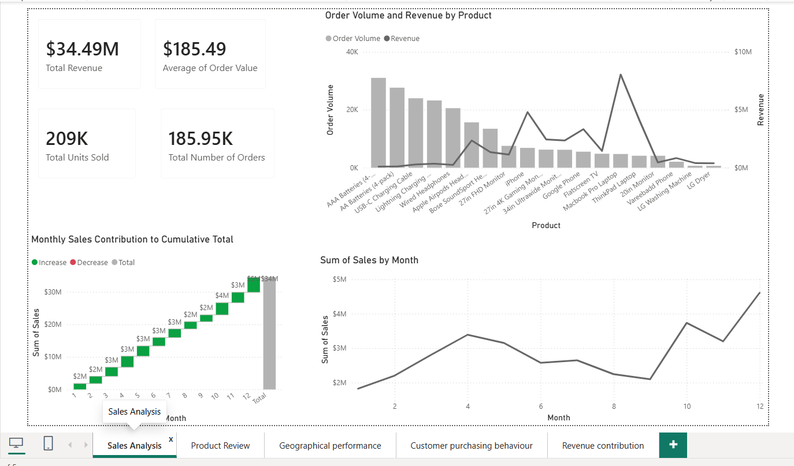

# 📊 Sales Performance & Purchasing Behaviour Analysis

## 1. Project Overview

This project focuses on analysing sales performance and customer purchasing behaviour using **Power BI, Excel and DAX**.

The objective is to transform transactional sales data into meaningful business insights by examining revenue trends, product performance, geographical distribution and purchasing patterns.

## 2. Tools & Technologies

- Microsoft Power BI
- Microsoft Excel
- DAX
- Data Cleaning & Transformation
- Data Visualization
- Business Analysis

## 3. Key Performance Indicators

| KPI | Value |
|---|---:|
| Total Revenue | $34.49M |
| Total Orders | 178,437 |
| Units Sold | 209,079 |
| Average Order Value | $193.30 |

## 4. Business Analysis & Key Findings

### 4.1 Sales Trends Analysis

**Business Questions:**
- How does revenue change over time?
- Which months contribute most to overall sales?
- How does monthly revenue compare with the previous month?

**Dashboard Visualization:**

**Key Findings:**
- [Insert your highest-revenue month and its revenue.]
- [Insert your lowest-revenue month and its revenue.]
- [Explain any significant month-over-month changes.]

**Business Implication:**

Understanding monthly sales patterns helps identify seasonal trends and periods requiring additional sales or marketing attention.

---

### 4.2 Product Performance Analysis

**Business Questions:**
- Which products generate the highest revenue?
- Which products sell the highest quantities?
- Are high-volume products necessarily the highest revenue generators?

**Dashboard Visualization:**

**Key Findings:**
- MacBook Pro Laptop generated approximately **$8.04M**, contributing around **23.3% of total revenue**.
- AAA Batteries recorded high sales volume but relatively low revenue.
- [Insert another product-level finding from your dashboard.]

**Business Implication:**

Product-level analysis helps identify major revenue contributors and distinguish between high-volume products and high-value products.

---

### 4.3 Geographical Performance Analysis

**Business Questions:**
- Which cities contribute the most to total revenue?
- How does sales performance vary geographically?
- Which geographical markets have growth opportunities?

**Dashboard Visualization:**

**Key Findings:**
- [Insert your highest-performing city.]
- [Insert your lowest-performing city.]
- [Highlight any geographical differences in revenue.]

**Business Implication:**

Geographical analysis can help businesses identify strong markets and potential opportunities for targeted marketing and resource allocation.

---

### 4.4 Customer Purchasing Behaviour Analysis

**Business Questions:**
- How does product price relate to quantity purchased?
- What purchasing patterns can be observed?
- During which periods is purchasing activity highest?

**Dashboard Visualization:**

**Key Findings:**
- Observed a negative association between product price and quantity purchased.
- [Insert your peak purchasing period.]
- [Add another finding from your customer or order analysis.]

**Business Implication:**

Understanding purchasing behaviour helps businesses evaluate pricing patterns, customer demand and potential product bundling opportunities.

---

### 4.5 Revenue Contribution Analysis

**Business Questions:**
- How does each month contribute to cumulative revenue?
- Which months make the largest contribution to overall sales?
- How does monthly revenue build towards the annual total?

**Dashboard Visualization:**

**Key Findings:**
- [Insert the month with the largest positive revenue contribution.]
- [Insert the month with the smallest or negative contribution, if applicable.]
- [Explain the overall cumulative revenue pattern.]

**Business Implication:**

Revenue contribution analysis helps identify the periods responsible for the largest additions to annual business performance.

---

## 5. Technical Implementation

Key technical concepts used:

- Data cleaning and transformation using Power Query.
- DAX measures for dynamic KPI calculations.
- Time-based sales analysis.
- Month-over-Month revenue comparisons.
- Interactive slicers and filters.
- Product and geographical analysis.
- Correlation analysis between price and quantity.

## 6. Project Files

| File | Description |
|---|---|
| `PowerBI/Sales Analysis Project.pbix` | Interactive Power BI dashboard |
| `Screenshots/` | Dashboard visualizations |
| `Dataset/` | Dataset source information |

## 7. Conclusion

This project demonstrates the application of data analytics and business intelligence techniques to evaluate sales performance and purchasing behaviour.

By combining interactive dashboards, DAX calculations and business-focused analysis, the project converts raw transactional data into actionable insights that support data-driven decision-making.
