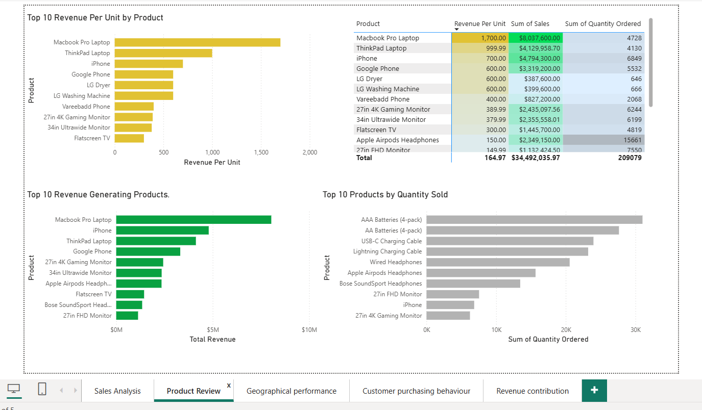
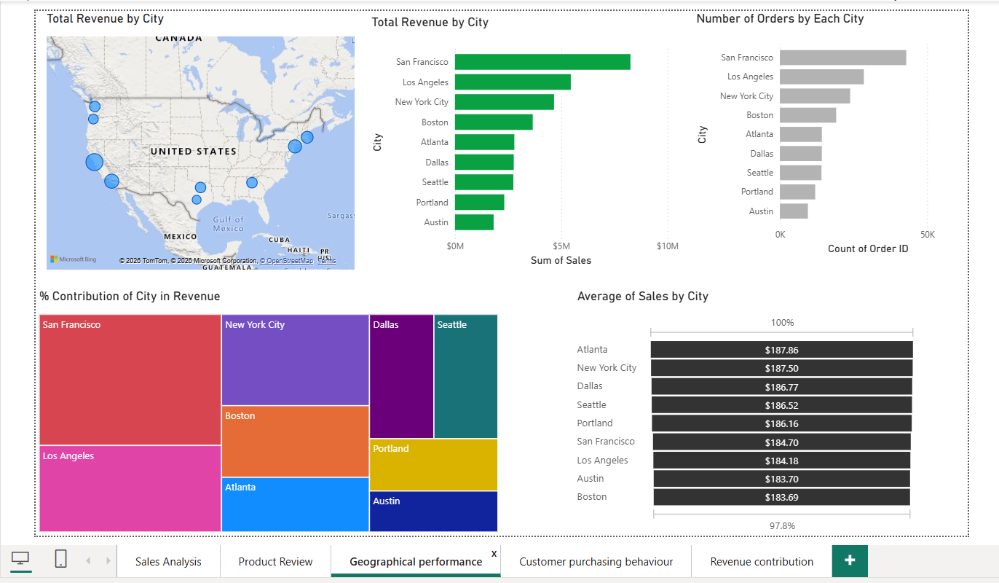
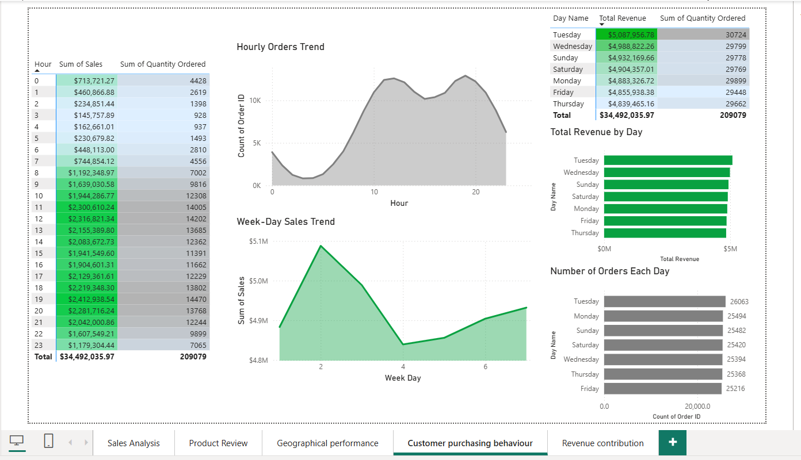
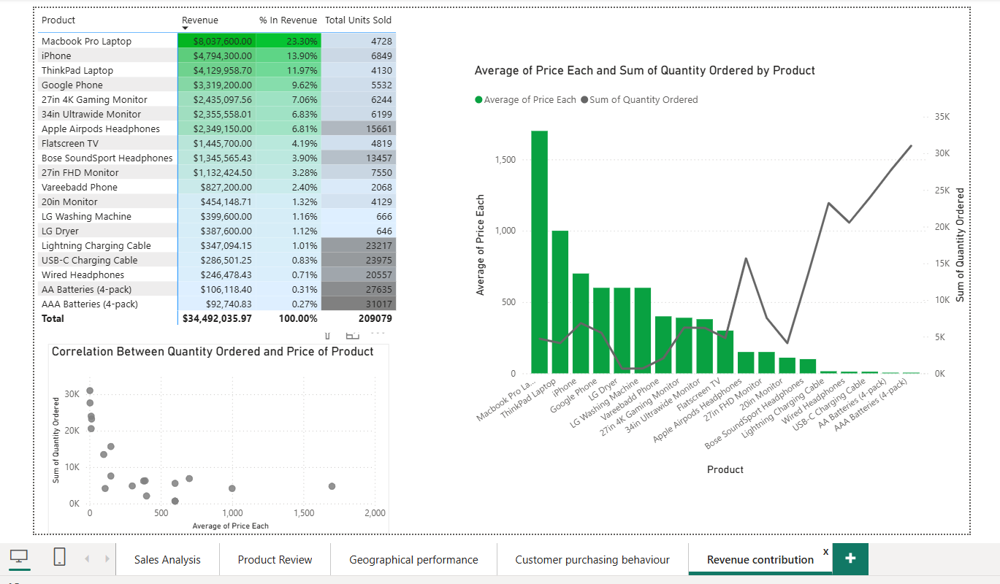

# 📊 Sales Performance & Purchasing Behaviour Analysis

## 1. Project Overview

This project focuses on analysing sales performance and customer purchasing behaviour using **Power BI, Excel and DAX**.

The objective is to transform transactional sales data into meaningful business insights by examining revenue trends, product performance, geographical distribution and purchasing patterns.

## 2. Tools & Technologies

- Microsoft Power BI
- Microsoft Excel
- DAX
- Data Cleaning & Transformation
- Data Visualization
- Business Analysis

## 3. Key Performance Indicators

| KPI | Value |
|---|---:|
| Total Revenue | $34.49M |
| Total Orders | 178,437 |
| Units Sold | 209,079 |
| Average Order Value | $193.30 |

## Business Analysis & Key Insights

### 1. Overall Sales Performance

**Key Insights:**

- Generated **$34.49M in total revenue** across approximately **185.95K orders**, with 209,079 units sold.
- December recorded the highest monthly revenue at approximately **$4.6M**, while January recorded the lowest at around **$1.8M**.
- October showed a notable increase in sales, reaching approximately **$3.7M**.
- Revenue fluctuated throughout the year, indicating variations in monthly sales performance.

**Business Takeaways:**

- Use historical sales trends to improve revenue forecasting.
- Plan promotional campaigns around periods of weaker sales.
- Monitor revenue and order volume together to evaluate business performance.

---

### 2. Product-Level Performance

**Key Insights:**

- **MacBook Pro Laptop** generated **$8.04M**, accounting for **23.30% of total revenue**.
- iPhone and ThinkPad Laptop followed with **$4.79M (13.90%)** and **$4.13M (11.97%)**, respectively.
- The top three products contributed approximately **49.17% of total revenue**.
- AAA Batteries (4-pack) recorded the highest sales volume at **31,017 units**, contributing only **0.27% of revenue**.
- AA Batteries (4-pack) sold **27,635 units**, contributing approximately **0.31% of revenue**.

**Business Takeaways:**

- Prioritise inventory planning for high-revenue products.
- Explore bundling and cross-selling opportunities for high-volume, low-revenue items.
- Evaluate products using both revenue contribution and quantity sold.

---

### 3. Geographical Sales Performance

**Key Insights:**

- **San Francisco** ranked highest in both total revenue and order volume.
- Los Angeles and New York City were the next major revenue contributors.
- Atlanta recorded the highest average order value at **$187.86**.
- New York City followed at **$187.50**, while Boston recorded the lowest at **$183.69**.
- Average order values remained relatively close across the analysed cities.

**Business Takeaways:**

- Prioritise strong-performing cities when planning regional sales initiatives.
- Investigate differences in average order value to identify upselling opportunities.
- Use geographical comparisons to guide marketing and resource allocation.

---

### 4. Purchasing Behaviour Analysis

**Key Insights:**

- Purchasing activity was concentrated during daytime and evening hours, with lower activity during early morning hours.
- **8 PM recorded the highest hourly revenue**, at approximately **$2.41M**.
- 7 PM and 9 PM generated approximately **$2.13M** and **$2.28M**, respectively.
- 3 AM recorded the lowest hourly revenue at approximately **$145.76K**.
- Tuesday generated the highest daily revenue at approximately **$5.09M**, while Thursday recorded the lowest at approximately **$4.84M**.
- Revenue remained relatively consistent across weekdays.

**Business Takeaways:**

- Align staffing and order-processing capacity with peak purchasing hours.
- Explore promotional campaigns during lower-activity periods.
- Maintain consistent operational support throughout the week.

---

### 5. Revenue Contribution & Price–Quantity Analysis

**Key Insights:**

- The scatter plot indicates a negative association between average product price and total quantity ordered.
- Lower-priced products, such as AAA Batteries and USB-C Charging Cables, recorded higher sales volumes.
- Premium products, including MacBook Pro Laptop and ThinkPad Laptop, generated substantial revenue despite lower quantities sold.
- MacBook Pro Laptop alone contributed **23.30% of total revenue**.
- Monthly revenue contributions accumulated to approximately **$34.49M**.
- December recorded the largest monthly contribution, while January recorded the smallest.

**Business Takeaways:**

- Evaluate pricing and sales volume together when assessing product performance.
- Maintain a balanced portfolio of premium and high-volume products.
- Use monthly revenue contribution patterns to support sales planning.

**Analytical Consideration:** The price–quantity comparison is based on aggregated product-level data. It indicates an association, not proof that higher prices directly cause lower demand.

---

## Technical Skills & Implementation

- **Power Query:** Data cleaning and transformation.
- **Power BI:** Interactive dashboard development and data visualization.
- **DAX:** Dynamic measures and KPI calculations.
- **Time-Series Analysis:** Monthly revenue trends and comparisons.
- **Product Analysis:** Revenue contribution and quantity analysis.
- **Geographical Analysis:** City-level sales comparisons.
- **Purchasing Behaviour:** Hourly and weekday sales patterns.
- **Correlation Analysis:** Price and quantity relationship.
- **Interactive Reporting:** Slicers, filters and dynamic visual interactions.

## 6. Project Files

| File | Description |
|---|---|
| `PowerBI/Sales Analysis Project.pbix` | Interactive Power BI dashboard |
| `Screenshots/` | Dashboard visualizations |
| `Dataset/` | Dataset source information |

## 7. Conclusion

This project demonstrates the application of data analytics and business intelligence techniques to evaluate sales performance and purchasing behaviour.

By combining interactive dashboards, DAX calculations and business-focused analysis, the project converts raw transactional data into actionable insights that support data-driven decision-making.
